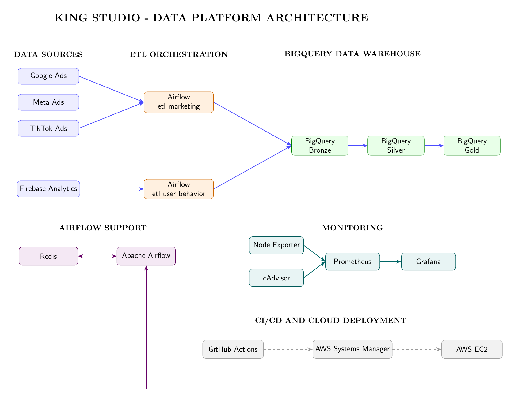
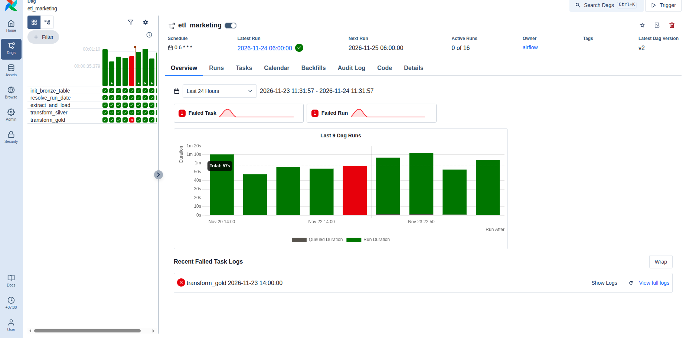
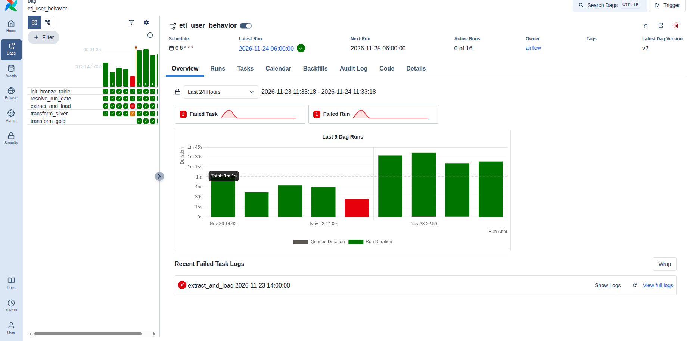
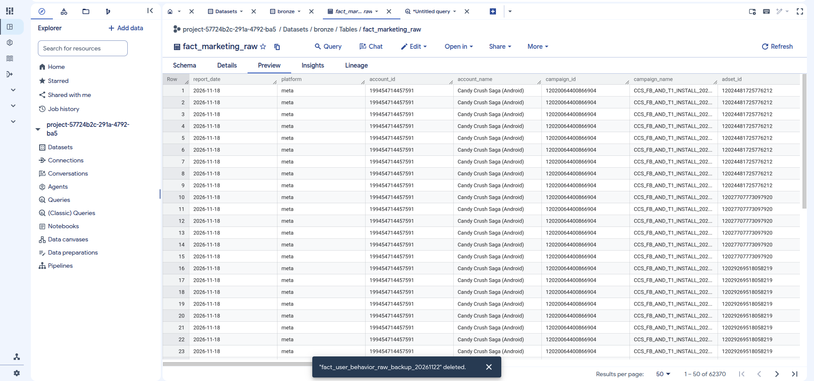
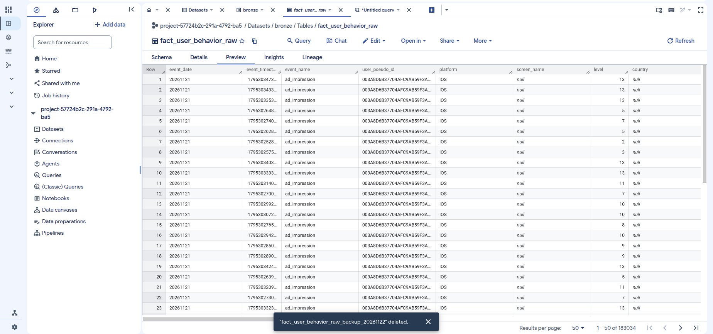

# KING STUDIO DATA PLATFORM

## 1. Tổng quan dự án

King Studio Data Platform là dự án xây dựng hệ thống dữ liệu tập trung, phục vụ việc thu thập, xử lý, lưu trữ và phân tích dữ liệu quảng cáo và hành vi người dùng của ứng dụng di động.

Hệ thống tích hợp dữ liệu từ ba nền tảng quảng cáo Google Ads, Meta Ads, TikTok Ads và dữ liệu sự kiện người dùng từ Firebase Analytics. Các quy trình ETL được điều phối bằng Apache Airflow, dữ liệu được lưu trữ và xử lý trên Google BigQuery.

Dự án áp dụng kiến trúc Medallion gồm ba lớp Bronze, Silver và Gold, đồng thời triển khai hệ thống giám sát hạ tầng bằng Prometheus và Grafana.

## 2. Kiến trúc hệ thống

## Architecture



### Công nghệ sử dụng

| Thành phần                  | Công nghệ                 |
| --------------------------- | ------------------------- |
| Điều phối quy trình ETL     | Apache Airflow 3.3.2      |
| Cơ chế thực thi             | CeleryExecutor            |
| Airflow Metadata Database   | PostgreSQL 16             |
| Message broker              | Redis 7.2                 |
| Kho dữ liệu                 | Google BigQuery           |
| Xử lý dữ liệu               | Python, Pandas, SQL       |
| Đóng gói và triển khai      | Docker, Docker Compose    |
| Hạ tầng máy chủ             | AWS EC2                   |
| Thu thập metrics            | Prometheus                |
| Trực quan hóa giám sát      | Grafana                   |
| Giám sát tài nguyên máy chủ | Node Exporter             |
| Giám sát container          | cAdvisor                  |
| CI/CD                       | GitHub Actions            |
| Triển khai từ xa            | AWS Systems Manager (SSM) |

## 3. Các quy trình ETL

Hệ thống gồm hai DAG chính, tương ứng với hai nhóm dữ liệu: dữ liệu quảng cáo và dữ liệu hành vi người dùng.

### 3.1. Quy trình ETL Marketing

**Tên DAG:** `etl_marketing`

**Nguồn dữ liệu:**

- Google Ads API.
- Meta Ads API.
- TikTok Ads API.

**Các bước thực hiện:**

1. Xác định ngày cần xử lý. Mặc định hệ thống lấy dữ liệu của ngày hôm trước theo múi giờ Việt Nam.
2. Khởi tạo bảng Bronze nếu bảng chưa tồn tại.
3. Gọi API để thu thập dữ liệu quảng cáo từ ba nền tảng.
4. Chuẩn hóa và hợp nhất dữ liệu thành một DataFrame thống nhất.
5. Ghi dữ liệu thô vào lớp Bronze trên BigQuery.
6. Làm sạch và loại bỏ bản ghi trùng lặp tại lớp Silver.
7. Tổng hợp dữ liệu và tạo các bảng phân tích tại lớp Gold.

**Cơ chế thu thập dữ liệu:**

Hệ thống sử dụng Rolling Window ba ngày, từ D-2 đến D, nhằm cập nhật các dữ liệu quảng cáo có thể thay đổi sau ngày phát sinh.



### 3.2. Quy trình ETL User Behavior

**Tên DAG:** `etl_user_behavior`

**Nguồn dữ liệu:** Firebase Analytics events được lưu trữ trên BigQuery.

Các sự kiện được thu thập:

- `first_open`: Người dùng mở ứng dụng lần đầu.
- `session_start`: Bắt đầu phiên sử dụng.
- `level_start`: Bắt đầu một màn chơi.
- `level_end`: Kết thúc một màn chơi.
- `in_app_purchase`: Phát sinh giao dịch mua hàng trong ứng dụng.
- `ad_impression`: Phát sinh lượt hiển thị quảng cáo.

**Các bước thực hiện:**

1. Xác định ngày cần xử lý theo múi giờ Việt Nam.
2. Khởi tạo bảng Bronze nếu bảng chưa tồn tại.
3. Truy vấn dữ liệu sự kiện Firebase trong khoảng thời gian ba ngày.
4. Chuẩn hóa kiểu dữ liệu và kiểm tra các trường thông tin quan trọng.
5. Ghi dữ liệu vào lớp Bronze trên BigQuery.
6. Làm sạch và loại bỏ bản ghi trùng lặp tại lớp Silver.
7. Tổng hợp dữ liệu và tạo các bảng phân tích tại lớp Gold.

Đối với dữ liệu doanh thu, hệ thống phân biệt doanh thu từ giao dịch mua hàng trong ứng dụng và doanh thu quảng cáo. Giá trị gốc và đơn vị tiền tệ được giữ riêng, không tự động quy đổi sang một đồng tiền khác.



### 3.3. Lịch chạy

| Thuộc tính                | Giá trị             |
| ------------------------- | ------------------- |
| Lịch chạy                 | Hằng ngày lúc 06:00 |
| Múi giờ                   | Asia/Ho_Chi_Minh    |
| Catchup                   | Tắt                 |
| Ngày xử lý mặc định       | Ngày hôm trước      |
| Khoảng thời gian thu thập | Ba ngày gần nhất    |
| Tham số chạy thủ công     | `run_date`          |

## 4. Thiết kế kho dữ liệu

Dữ liệu được tổ chức theo kiến trúc Medallion với ba lớp Bronze, Silver và Gold.

### 4.1. Bronze Layer – Dữ liệu thô

Lưu trữ dữ liệu được thu thập từ các hệ thống nguồn trước khi thực hiện các bước làm sạch và biến đổi.

| Bảng dữ liệu             | Mô tả                                                       |
| ------------------------ | ----------------------------------------------------------- |
| `fact_marketing_raw`     | Dữ liệu quảng cáo thô từ Google Ads, Meta Ads và TikTok Ads |
| `fact_user_behavior_raw` | Dữ liệu sự kiện thô từ Firebase Analytics                   |

Dữ liệu Marketing được ghi vào Bronze theo cơ chế `WRITE_APPEND`. Dữ liệu User Behavior được kiểm tra schema và chuẩn hóa trước khi tải lên BigQuery.





### 4.2. Silver Layer – Dữ liệu đã làm sạch

Thực hiện chuẩn hóa dữ liệu, xử lý bản ghi trùng lặp và giữ lại bản ghi mới nhất dựa trên thời điểm trích xuất `extracted_at`.

| Bảng dữ liệu               | Mô tả                                  |
| -------------------------- | -------------------------------------- |
| `fact_marketing_clean`     | Dữ liệu quảng cáo đã làm sạch          |
| `fact_user_behavior_clean` | Dữ liệu hành vi người dùng đã làm sạch |

Việc loại bỏ bản ghi trùng lặp sử dụng hàm `ROW_NUMBER()` kết hợp với các khóa nghiệp vụ và thời điểm trích xuất dữ liệu.

### 4.3. Gold Layer – Dữ liệu phục vụ phân tích

Lớp Gold gồm sáu bảng dữ liệu tổng hợp, được chia thành hai nhóm.

**Nhóm Marketing**

| Bảng dữ liệu          | Mục đích phân tích                                                |
| --------------------- | ----------------------------------------------------------------- |
| `fact_campaign_daily` | Hiệu quả quảng cáo theo chiến dịch và ngày                        |
| `fact_adset_daily`    | Hiệu quả quảng cáo theo nhóm quảng cáo và ngày                    |
| `fact_ad_performance` | Hiệu quả quảng cáo ở cấp độ quảng cáo, có phân tách theo quốc gia |

Các chỉ số chính:

- Chi phí quảng cáo (Spend).
- Lượt hiển thị (Impressions).
- Lượt nhấp (Clicks).
- Lượt cài đặt (Installs).
- Lượt mua hàng (Purchases).
- Giá trị mua hàng (Purchase Value).
- Tỷ lệ nhấp (CTR).
- Chi phí trên mỗi lượt cài đặt (CPI).
- Tỷ suất hoàn vốn quảng cáo (ROAS).

**Nhóm User Behavior**

| Bảng dữ liệu                 | Mục đích phân tích                                           |
| ---------------------------- | ------------------------------------------------------------ |
| `fact_level_funnel_daily`    | Phân tích hoạt động bắt đầu và hoàn thành màn chơi           |
| `fact_user_engagement_daily` | Phân tích mức độ tương tác và hoạt động người dùng hằng ngày |
| `fact_user_revenue_daily`    | Phân tích doanh thu từ mua hàng trong ứng dụng và quảng cáo  |

Các chỉ số chính:

- Số lượt bắt đầu và kết thúc màn chơi.
- Số người dùng tham gia từng màn chơi.
- Tổng số sự kiện.
- Daily Active Users (DAU).
- Số lượt mở ứng dụng lần đầu.
- Số phiên sử dụng.
- Số giao dịch mua hàng.
- Số người dùng phát sinh giao dịch.
- Doanh thu mua hàng trong ứng dụng.
- Số lượt hiển thị quảng cáo và doanh thu quảng cáo.

## 5. Giám sát và cảnh báo hệ thống

Dự án triển khai hệ thống monitoring nhằm theo dõi tình trạng hoạt động và mức tiêu thụ tài nguyên của máy chủ EC2 cũng như các Docker container.

### 5.1. Các thành phần

- **Prometheus:** Thu thập và lưu trữ metrics, thời gian lưu dữ liệu được cấu hình là ba ngày.
- **Node Exporter:** Thu thập thông tin tài nguyên của máy chủ EC2.
- **cAdvisor:** Thu thập metrics của các Docker container.
- **Grafana:** Trực quan hóa metrics và thiết lập cảnh báo.

### 5.2. Các Prometheus scrape targets

| Job           | Target               |
| ------------- | -------------------- |
| Prometheus    | `localhost:9090`     |
| Node Exporter | `node-exporter:9100` |
| cAdvisor      | `cadvisor:8080`      |

### 5.3. Cấu hình cảnh báo

Các cảnh báo Grafana đã được tạo:

1. **EC2 - High Memory Usage:** Cảnh báo khi mức sử dụng bộ nhớ vượt ngưỡng.
2. **EC2 - High CPU Usage:** Cảnh báo khi mức sử dụng CPU vượt ngưỡng.
3. **EC2 - High Disk Usage:** Cảnh báo khi dung lượng ổ đĩa sử dụng vượt ngưỡng.
4. **EC2 - Monitoring Target Down:** Cảnh báo khi các monitoring target không hoạt động.

Grafana được cấu hình Discord Contact Point để gửi thông báo khi phát sinh cảnh báo.

## 6. Theo dõi chi phí BigQuery

Dự án sử dụng truy vấn trên `region-us.INFORMATION_SCHEMA.JOBS_BY_PROJECT` để theo dõi hoạt động truy vấn BigQuery.

Các thông tin được thống kê:

- Số lượng truy vấn hoàn thành theo ngày.
- Tổng dung lượng dữ liệu được tính phí.
- Chi phí truy vấn ước tính theo mức giá On-demand.

Chi phí ước tính sử dụng mức giá giả định 6,25 USD/TiB cho xử lý truy vấn tại khu vực US, trước khi áp dụng hạn mức miễn phí.

Đây là số liệu ước tính cho chi phí xử lý truy vấn, không phải hóa đơn thanh toán thực tế và chưa bao gồm các khoản phí khác như lưu trữ dữ liệu.

## 7. Tự động hóa CI/CD

Dự án sử dụng GitHub Actions để kiểm tra mã nguồn và tự động triển khai phiên bản mới lên máy chủ EC2.

### 7.1. Continuous Integration (CI)

Workflow CI thực hiện các bước:

- Kiểm tra cú pháp Python thông qua `compileall`.
- Kiểm tra các tệp SQL tồn tại và không bị rỗng.
- Kiểm tra tính hợp lệ của cấu hình Docker Compose.
- Kiểm tra lỗi định dạng và khoảng trắng trong Git diff.

### 7.2. Continuous Deployment (CD)

Workflow CD được kích hoạt sau khi CI thành công trên nhánh `main`.

Quy trình triển khai:

1. GitHub Actions xác thực với AWS thông qua OIDC.
2. Sử dụng AWS Systems Manager Run Command để thực thi lệnh trên EC2.
3. Đồng bộ mã nguồn mới nhất từ nhánh `main`.
4. Kiểm tra cấu hình Docker Compose.
5. Triển khai hoặc cập nhật các dịch vụ bằng Docker Compose.

Thư mục dự án trên EC2:

`/home/ubuntu/king-studio-data-platform`

### 7.3. Git Workflow

Dự án áp dụng quy trình phát triển dựa trên Git branch và Pull Request:

1. Tạo feature branch từ nhánh `main` để phát triển tính năng hoặc cập nhật tài liệu.
2. Commit và push các thay đổi lên feature branch.
3. Tạo Pull Request để đề xuất merge thay đổi vào `main`.
4. GitHub Actions tự động chạy CI để kiểm tra mã nguồn trên Pull Request.
5. Sau khi kiểm tra thành công, Pull Request được merge vào `main`.
6. Sự kiện cập nhật `main` kích hoạt workflow CD sau khi CI hoàn tất thành công.
7. GitHub Actions sử dụng AWS OIDC và Systems Manager để triển khai phiên bản mới lên EC2.


## 8. Cấu trúc thư mục dự án

```
.
├── .github/
│   └── workflows/
│       ├── ci.yml
│       └── cd.yml
├── config/
│   └── airflow.cfg
├── dags/
│   ├── __init__.py
│   ├── etl_marketing.py
│   ├── etl_user_behavior.py
│   └── include/
│       ├── ads_api/
│       │   ├── __init__.py
│       │   ├── google.py
│       │   ├── meta_ads.py
│       │   └── tiktok.py
│       ├── bigquery/
│       │   ├── __init__.py
│       │   └── load.py
│       └── firebase/
│           ├── __init__.py
│           └── flat_event.py
├── docs/
│   └── architecture/
│   │   └── king-studio-architecture.png
│   └── images/
│       └── etl_mkt.png
│       └── etl_user.png
│       └── mkt_bronze.png
│       └── mkt_bronze.png
├── monitoring/
│   └── prometheus/
│       └── prometheus.yml
├── plugins/
├── secrets/
│   ├── gcp-sa-dest.json
│   └── gcp-sa-source.json
├── sql/
│   ├── bronze/
│   │   ├── create_bronze_marketing.sql
│   │   └── create_bronze_user_behavior.sql
│   ├── silver/
│   │   ├── silver_marketing_clean.sql
│   │   └── silver_user_behavior_clean.sql
│   └── gold/
│       ├── gold_fact_ad_performance.sql
│       ├── gold_fact_adset_daily.sql
│       ├── gold_fact_campaign_daily.sql
│       ├── gold_fact_level_funnel_daily.sql
│       ├── gold_fact_user_engagement_daily.sql
│       └── gold_fact_user_revenue_daily.sql
├── .env.example
├── .gitignore
├── docker-compose.yaml
├── Dockerfile
├── README.md
└── requirements.txt

```

## 9. Môi trường triển khai

Hệ thống được triển khai trên máy chủ AWS EC2 sử dụng Ubuntu. Docker Compose quản lý các dịch vụ:

- Apache Airflow.
- PostgreSQL.
- Redis.
- Prometheus.
- Grafana.
- Node Exporter.
- cAdvisor.

BigQuery được sử dụng làm kho dữ liệu trung tâm.

**Lưu ý về hạ tầng:** Dự án hiện triển khai máy chủ xử lý trên AWS EC2, thay vì Google Cloud Compute Engine như yêu cầu hạ tầng ban đầu. Google BigQuery vẫn được sử dụng làm nền tảng lưu trữ và xử lý dữ liệu.

## 10. Bảo mật thông tin

- API token và mật khẩu được lưu trong biến môi trường hoặc tệp cấu hình bảo mật.
- Google Cloud Service Account JSON không được đưa lên GitHub.
- Tệp `.env` và thư mục `secrets/` được loại trừ khỏi Git thông qua `.gitignore`.
- Tắt chức năng tự đăng ký tài khoản trên Grafana.
- Grafana chỉ bind vào localhost trên máy chủ EC2 và được truy cập thông qua phương thức kết nối bảo mật đã cấu hình.

Không công khai API token, mật khẩu, private key, Service Account JSON hoặc các thông tin xác thực trong tài liệu và repository.

## 11. Phạm vi triển khai hiện tại

Các hạng mục đã được triển khai:

- Hai quy trình ETL bằng Apache Airflow.
- Thu thập dữ liệu quảng cáo từ ba nền tảng Google Ads, Meta Ads và TikTok Ads.
- Thu thập dữ liệu hành vi người dùng từ Firebase Analytics.
- Xây dựng ba lớp dữ liệu Bronze, Silver và Gold trên BigQuery.
- Sáu bảng dữ liệu phân tích tại lớp Gold.
- Hệ thống monitoring bằng Prometheus và Grafana.
- Cấu hình cảnh báo Grafana và thông báo qua Discord.
- Theo dõi chi phí xử lý truy vấn BigQuery.
- Tự động hóa kiểm tra và triển khai bằng GitHub Actions.

Các dashboard phục vụ phân tích nghiệp vụ và khai thác insight sẽ được tiếp tục hoàn thiện trong giai đoạn tiếp theo.